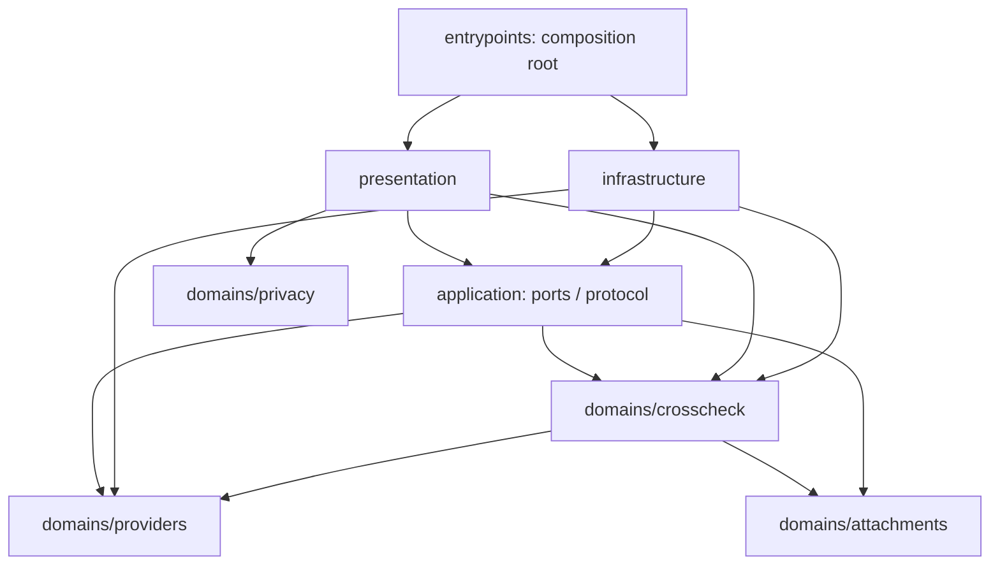

# 아키텍처

## 폴더와 책임

```text
src/
  domains/
    providers/        공급자 식별, 허용 origin, 대화 연결 참조
    attachments/      원본 파일 메타데이터·전송 크기 경계
    crosscheck/       실행/답변/근거 모델, 예산, 단계 전환, 프롬프트, 복구 규칙
    privacy/          URL/민감정보 표시 규칙
  application/        자동 파이프라인, Platform 포트, 페이지 명령·응답 스키마
  infrastructure/
    chrome/           Chrome 권한/탭/메시지/세션 저장 구현
    providers/        사이트별 DOM 및 공급자 페이지의 내부 요청/완료 검증
  presentation/
    shell/            사이드패널 상태·내비게이션·디자인 토큰
    crosscheck/       답변 카드
entrypoints/          조립 지점: Platform 구현 주입, background, 페이지 bridge
tests/
  unit/{crosscheck,attachments,providers,privacy,architecture}/
  browser/            실제 Chromium에서 UI 및 built bridge 검사
  extension/          실제 MV3 설치/권한/세션 검사 (별도 머신 필요)
  fixtures/{application,providers,attachments}/  합성 응답/DOM/파일, 실계정 데이터 없음
docs/{research,architecture,security,testing,development,release}/
```

도메인 데이터는 `domains/*/model.ts`, 테스트 데이터는 `tests/fixtures`에 둡니다. 실행 중 질문·답변과 첨부 메타데이터는 Chrome `storage.session`, 첨부 원본은 열린 패널과 업로드 중인 bridge의 메모리에만 존재합니다. 다운로드와 빌드 산출물은 `.output/`, 테스트 결과는 `test-results/`에 생성하며 Git에서 제외합니다. 개인 질문·대화·토큰을 코드나 fixture로 수집하지 않습니다.



`presentation`은 Chrome 구현을 import하지 않고 주입된 `Platform`만 사용합니다. 도메인은 브라우저, React, 인프라를 모릅니다. `tests/unit/architecture/boundaries.test.ts`가 역방향 import, 순환 import, 상위 계층의 직접 `chrome.*` 호출을 검사합니다. 네이티브 UI 기능인 클립보드·다운로드·Web Locks는 화면의 책임입니다.

## 기본 DOM 흐름과 장애 처리

1. 시작 클릭으로 선택한 origin 권한을 한 번 요청하고 각 대상 탭의 ISOLATED world에 bridge를 주입합니다. 항상 top frame만 사용합니다.
2. 메인 대화 가져오기는 페이지에 불러온 완료된 질문·답변 쌍을 순서대로 캡처하고 탭/문서 ID/정확한 URL을 고정합니다. 마지막 메인 답변은 초기 수집에서 재사용하고 이전 턴의 맥락은 모든 단계의 JSON 자료에 포함합니다. 원본의 이전 턴 수정이나 사용자의 추가 대화는 이후 메인 대화 전송을 중단합니다.
3. 도메인이 단계별 프롬프트를 만듭니다. 시작 버튼의 공유 안내에 따라 한 번 시작한 유한 파이프라인을 application 계층이 실행합니다. 각 AI 탭을 활성화하고 전송·답변 수집을 차례로 마친 뒤 다음 작업으로 이동합니다. collect → review → synthesize 사이의 추가 클릭은 없습니다. 패널은 실행 중 열린 상태로 유지해야 합니다.
4. 전송 의도를 세션에 먼저 저장합니다. 각 작업 ID는 해당 페이지에서 한 번만 시도하며 자동 재전송하지 않습니다.
5. DOM bridge는 입력 덮어쓰기/동시 생성/다중 입력란을 거부합니다. 기존 메시지 ID 집합과 새 질문·답변의 대응, 전송한 질문과의 일치·완료 표시·안정 시간을 확인합니다. 확인되지 않은 출력은 완료로 표시하지 않습니다.
6. 패널이 1초 간격으로 진행을 확인합니다. 최대 3분; bridge가 15초간 패널의 조회를 받지 못하면 중단됩니다. 이미 전송된 생성 자체를 취소하는 것은 아닙니다.
7. 패널 복원 시 `sending`을 `interrupted`로 바꿉니다. 애매한 전송을 재시도하지 않고 사용자가 사이트에서 직접 결과를 가져옵니다.
8. 최종 단계는 후보/비판/근거를 다시 종합하여 저장한 원래 메인 대화에 보냅니다. 페이지/문서가 달라지면 전송하지 않습니다. 다른 AI의 새 대화 생성에 따른 첫 URL 변경은 bridge가 감지한 결과에만 반영합니다.

첨부 원본은 사용자가 패널에서 한 번 선택합니다. 전송 경계에서 크기·인코딩·SHA-256을 검증하고, 각 AI의 업로드 입력란에 동일한 파일을 전달합니다. 완료된 첨부 상태를 확인한 뒤에만 질문을 입력·전송합니다. 파일 업로드 오류, 기존 첨부 초안, 전송 전 파일 교체는 전송을 중단합니다. 같은 탭·문서·대화에 성공적으로 전달한 기록이 있는 후속 요청에서는 다시 업로드하지 않습니다. 복원 후에는 저장된 이름·크기·내용 확인값과 일치하는 원본을 다시 선택해야 합니다.

Web Locks는 동일 확장의 패널 여러 개가 동시에 컨트롤러가 되는 것을 막습니다. service worker는 패널 열기, 세션 접근 수준 설정, Chrome이 내려받은 업데이트의 버전 안내만 담당하므로 AI 응답이나 업데이트를 기다리느라 강제로 유지하지 않습니다. 업데이트 확인·설치는 Chrome에 맡기며 패널은 수동 안내와 수동 확인 화면 진입만 제공합니다. [업데이트와 저장소 수명](../release/updates.md).

연결 상태 자동 확인과 중단 후 재개는 저장된 탭·문서·정확한 URL을 변경하지 않습니다. 대상이 달라지면 명시적으로 다시 연결해야 하며, 상태 확인만으로 다른 대화에 전송 대상을 옮기지 않습니다.

## 선택적 Claude 원본 검토

`Run.kind: 'claude-peer'`는 현재 렌더된 비-Claude 원본과 선택한 TXT/PNG를 기존 collect/economy review 프롬프트로 보내는 별도 intent입니다. `importedRun`과 `promptFor`를 재사용하고 두 요청에 전체 승인 범위를 유지합니다. 원래 메인 답변은 재사용하며 원본에는 새 요청을 보내지 않습니다. 이 intent는 source+Claude만 허용하고 collect → review에서 끝나므로 복원·수동 답변도 synthesis나 일반 intent로 바꾸지 않습니다. 기본 DOM 파이프라인은 유지합니다.

application은 원본 재검사·저장된 전송 의도·단계와 완전한 파일 manifest를 소유합니다. Chrome 인프라는 비활성 새 Claude 홈·문서/URL·정확한 sidepanel 발신자와 전용 RPC를 소유하고 presentation은 주입된 Platform을 사용합니다. provider의 `claude/session.ts`, `peer.ts`, `originals.ts`는 기존 진단과 계정/모델·SSE·정확한 history 검증을 공유합니다. 서버 대화/메시지/업로드 receipt는 그 페이지 closure에만 있으며 인증값은 읽지 않습니다.

`Binding.threadId`는 확장이 만든 로컬 UUID로 서버 대화 ID가 아닙니다. snapshot → attach/reconnect → 연결 UI의 동등성 검사에서 이를 보존하고, inspect는 소유권 불일치를 거부합니다. 파일 delivery receipt 동등성에도 같은 소유권을 포함합니다. ordinary Claude 준비에서 정상 saved binding은 그대로 검사하지만 unbound인 경우 새 홈을 만들어 이전 예약 peer를 재사용하지 않습니다. 이미 시도한 peer의 페이지/session을 잃으면 대체 대화 할당·DOM fallback·재시도 없이 멈춥니다.

원본은 기존 개수/총크기/해시 경계와 함께 provider에서 UTF-8 TXT 64 KiB 이하·PNG 각 축 4096 이하만 받습니다. TXT는 첫 생성의 inline attachment, PNG는 원본 multipart를 한 번 업로드해 확인한 receipt만 사용합니다. 모든 업로드를 기다리고 첫 human의 정확한 saved-history membership을 확인한 뒤 전달 완료로 기록합니다. review에는 새 바이트가 없어도 전체 승인 manifest가 같아야 하며 첫 history/receipt는 그대로여야 합니다. 이 검증은 로컬 바이트→업로드 receipt→history 참조의 대응이지 서버 바이트 해시의 독립 증명은 아닙니다.

현재 수용 증거와 남은 범위는 [검증 기록](../testing/validation.md), 구현 계약은 [peer 계획](../development/claude-peer-review-plan.md)이 소유합니다. GET과 다음 POST의 검사는 원자적이지 않으므로 최종 readback은 경합을 탐지할 수 있어도 이미 수락된 요청을 되돌리지 않습니다. 임의 기존 메인 이어쓰기는 이 구조의 수용 범위가 아닙니다.

## 확장 지점

Gemini 준비 확인은 생성 없는 별도 metadata intent입니다. Chrome 인프라가 ID/status를 먼저 저장하고 새 비활성 홈의 ISOLATED bridge에 모델 capture를 요청합니다. bridge의 로컬 문서 UUID와 Chrome scripting의 native document ID를 각각 검사한 뒤 같은 top-frame MAIN에 self-contained 보안 설정 projection과 실제 consumer preflight를 실행합니다. 각 결과의 frame/document와 strict schema를 검증하고 원래 binding을 다시 확인합니다. 모델 receipt는 명시적 finish의 재확인과 cleanup까지 pending입니다. 사용자 조작·취소는 receipt를 무효화하고 실패한 cleanup은 페이지 reload/reconnect까지 mutation을 막습니다. [진단 경계](../development/gemini-protection-diagnostics-plan.md).

Task 12 preflight는 정확한 compact model host의 own numeric context와 AGk view slot 28 소유권을 확인합니다. 직접 host/component 또는 정확한 tooltip LContainer 하나만 수용한 뒤, 정해진 세 declaration link와 TNode 관계로 native owner의 실제 `sV` consumer를 확인하고 그 own selected service/API 참조를 읽습니다. Root cache lookup·runtime getter·hydration·injector/provider method 호출·네트워크·DOM 변경은 없습니다. Application은 strict `candidate` 또는 고정 사유의 `unsupported` 계약을 소유하고, presentation은 주입된 Platform으로 그 한계를 표시합니다. 모델 표시·고정 metadata만 일시적으로 반환하며 context ID·service 참조·인증값·private mode key는 페이지 밖으로 보내지 않습니다. Session은 ID/status만 저장합니다. Candidate는 root factory 출처·transparent proxy 부재·attestation·실제 dispatch/connection callback·생성·응답·모델 사용 권한의 증명이 아닙니다. 정확한 source profile은 [전송 조사](../research/background-web-transport.md), 구현 범위는 [preflight 계획](../development/gemini-client-capability-plan.md), 실제 수용 범위는 [검증 기록](../testing/validation.md)이 소유합니다.

새 공급자는 provider 도메인과 DOM 어댑터, 고정 origin 권한, 합성 fixture, 실로그인 검증 기록을 함께 추가합니다. API 모드를 넣는다면 `Platform`의 전송 구현을 분리하고 별도 키 저장/권한/비용 동의 설계를 먼저 수행합니다. 웹 로그인과 API 무료 크레딧은 서로 다른 기능입니다.

모델 목록은 웹 메뉴에서 읽고 실제 선택 상태를 확인합니다. 자동 전송과 모델 메뉴 조작은 겹치지 않습니다. 메뉴 미지원은 빈 목록과 안내로 반환하며 가용 모델을 추측하지 않습니다. UI에는 연결된 탭과 입력란 확인 결과를 구별해 표시합니다.

## Gemini 버튼 준비 관찰

준비 확인 화면의 명시적 관찰은 기존 Gemini 권한으로 새 비활성 홈 하나를 만들고 ISOLATED bridge에서 DOM만 읽습니다. 페이지와 빈 입력란 준비 후 별도의 15초 구간에서 실제 모델 헤더 구조를 관찰하며, 초기 표시 상태와 변화 여부를 함께 검증합니다. 준비 시점의 유한 분류와 탭 정리 결과만 패널 메모리에 반환합니다. 모델 메뉴·MAIN/private preflight·생성·세션 저장을 호출하지 않습니다. bridge 문서 예약은 종료 후에도 다른 모델/생성 작업을 막고, 탭을 닫기 직전에 같은 문서·빈 입력란·사용자 변경 없음·비활성 상태를 다시 확인합니다. 불확실하면 탭을 유지합니다. 관찰 결과는 고정 응답이나 저장 기록의 수용 증거가 아니며 실제 시험의 준비 제한 시간을 바꾸지 않습니다. [검증 기록](../testing/validation.md).

## Gemini 고정 SDK 응답 시험

별도 `Gemini 응답 시험`은 새 비활성 홈에 고정된 비민감 문장 한 번만 보내는 실험입니다. Application은 문장·결과·유한 실패 사유와 Platform 포트를 소유하고 Chrome 인프라는 의도 선저장, 문서 확인, ISOLATED 예약, 로컬 MAIN 번들 실행과 정리를 담당합니다. Provider 어댑터는 실제 소유 클라이언트·모델 catalog·요청 packet·정상 SDK 전송·완료 상태·동일 대화의 한 번의 history 조회를 검증합니다. 전체 검토·파일·원래 메인 반환을 대체하지 않습니다.

Provider 내부의 RPC와 cold WebChannel 경로는 서로 다른 guard를 사용하며 한 intent가 경로를 바꾸지 않습니다. Cold 경로는 원래 observable의 한 번의 구독에서만 정상 factory·설정·논리 query를 허용합니다. 같은 메시지의 source-owned 전송 복구는 새 생성 허가가 아니며 물리 전송 횟수나 과금 한 번을 보장하지 않습니다. 실제 raw 수신·정규화·현재 projected event의 대응은 원래 dispatch 안에서 확인하고, 더 넓은 수신 깊이는 안전한 취소 지연에 사용합니다. 기존 health poll은 guard의 실패도 전달합니다. 공개 준비 metadata는 계속 unsupported이며 이 내부 경로를 성공으로 표시하지 않습니다. 좁은 소스·소유권·정리 계약은 [cold 경로 계획](../development/providers/gemini/cold-webchannel-fixed-trial-plan.md)이 소유합니다.

MAIN 번들은 처음에는 요청하지 않습니다. 동일 native 문서의 trusted scripting 결과로 일회성 무작위 handle/capability를 받아 고정 `lease`/`stop`만 호출합니다. registry는 불변이며 임의 URL·헤더·문장·모델·함수 실행 명령이 없습니다. capability는 공급자 인증값과 별개이고 세션에 저장하지 않습니다. lease 만료·중단·사용자 입력·문서 이동 뒤 재시작하지 않으며 종료한 문서는 계속 격리합니다. 원래 stream에 묶어 확인한 대화만 provider-local 소유권 검사에 사용하고 대화 ID는 확장으로 내보내지 않습니다. 첫 valid lease의 exact-home 확인, 진행 중 SDK의 실제 current 검사와 종료 후 safe-retirement 검사는 각각 별개입니다. 닫을 수 없는 상태를 진행 실패로 바꾸거나 원래 terminal 사유를 덮지 않습니다.

외부 구현 비교와 공개 source 리뷰 뒤 수신 경계를 축소했습니다. 완료 기준은 실제 원래 요청에 묶인 full final 또는 source terminal marker, 원래 stream의 정상 종료·같은 요청의 downstream 성공 acknowledgement와 exact raw server history입니다. Full final의 live/saved 비교는 유지하며 marker-only에서 보이지 않은 live 필드를 추정하지 않습니다. 모든 관측된 partial candidate와 continuation/action 대응을 검사하고 완료 뒤에도 nested request scope를 검사합니다. 처리된 IId/선택 화면 DTO의 전체 동일성은 성공 증거에서 제외하며, 해당 context·오류·중단 관찰과 현재 store CID의 blank/owned 경계는 유지합니다. 생성 허가는 terminal 응답을 downstream으로 전달하기 전에 닫고, 이미 전송했을 수 있는 요청은 재시도하지 않습니다. 탭 삭제 직전 같은 native 문서의 새로운 소유권 결과·실제 active store의 Ae/CID·빈 composer·사용자 조작 없음·비활성 상태를 요구하며 불확실하면 탭을 남깁니다. 실제 SDK 취소가 서버 생성 중단을 보장하지는 않습니다. 검사 종류별 결과는 [검증 기록](../testing/validation.md), 좁은 계약과 source 근거는 [시험 계획](../development/gemini-sdk-fixed-text-trial-plan.md)이 소유합니다.
